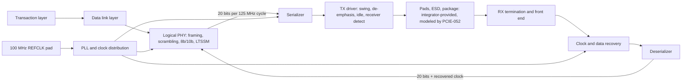

# On-chip SKY130 PHY architecture

Status: **direction selected by the user, 2026-11-07** (on-chip PHY, with digital-only fallback). Rates, partitions and circuit topologies below are proposals that PCIE-003 freezes and PCIE-045/046/049/007/008 must qualify. Nothing here asserts that SKY130 meets the 2.5 Gb/s requirements. The PHY macros are delivered as part of a verified core; pads and packaging are modeled, not designed.

## Partition

- **Digital core** (standard cells, OpenLane): transaction layer, data link layer and logical PHY, including scrambling, 8b/10b, ordered sets, LTSSM and elastic buffering. Encoding and scrambling happen exactly once, here.
- **PMA** (custom transistor-level macros): PLL, serializer, TX driver, RX front end, CDR and deserializer, plus electrical-idle and receiver-detect circuits. Each is delivered as a DRC/LVS-clean macro with GDS, LEF and timing abstracts for PCIE-040.
- **Support blocks:** bias and references, plus termination calibration if needed (PCIE-059); the REFCLK input receiver belongs with the PLL (PCIE-049). REFCLK electrical requirements come from the PCI Express CEM specification, which was not supplied and must be obtained.
- **Outside the core** (recorded in PCIE-003, stated in the PCIE-058 integration guide): pads and ESD within the PCIE-052 limits, TX AC-coupling capacitors, which receiver detection relies on; any precision calibration resistor; REFCLK termination; supply decoupling.
- **Interface** (PCIE-004): proposed 20 encoded bits per 125 MHz cycle each way, with explicit bit order across 10-bit symbol boundaries, plus control and status for electrical idle, receiver detect, polarity, lock, power states and reset.

## Proposed rate architecture (to be qualified)

- **Clocking:** the PLL multiplies the host 100 MHz REFCLK. Two options for PCIE-003/045 to decide between: full-rate 2.5 GHz clocks, or half-rate 1.25 GHz clocks with a double-edge final serializer stage and double-edge sampling in the CDR. Half-rate relaxes the fastest clock and is the starting hypothesis.
- **Serializer split:** early stages in standard cells at their measured reliable rate; final stages in current-mode logic (CML). PCIE-045 measures where the boundary must sit.
- **TX driver:** differential output meeting section 4.3.3 swing and -3.5 dB de-emphasis limits, common-mode control, termination (calibrated if needed), electrical idle, and receiver detection by sensing the line's charging behavior.
- **RX:** termination and common mode, optional equalization, samplers, CDR (PLL-based, bang-bang with phase interpolation, or oversampling, as PCIE-046 recommends), deserializer, electrical-idle detection and lock detection.
- **Lock time:** the CDR must relock within the advertised N_FTS fast-training sequences for L0s exit (section 4.2.4.3: about 4 µs at N_FTS 255). PCIE-046/008 set the budget; PCIE-017/031 may only advertise what it supports.

## Method

Each analog block runs in three tickets: schematic design, layout and extraction, then extracted-layout qualification and macro delivery (building blocks 061/062/045, PLL 063/064/049, TX 065/066/007, RX 067/068/008).

1. **Building blocks first (PCIE-061/062/045):** CML buffer, latch, 2:1 mux, divider, level converter, sampler and VCO candidate, each laid out, extracted and simulated across corners before integration. This carries forward the transistor-first approach of the earlier discrete plan, now on-chip.
2. **CDR feasibility before layout (PCIE-046):** behavioral plus critical-block transistor studies, with a go / no-go / unknown recommendation reported to the user.
3. **Early loopback top (PCIE-060):** hardened logical PHY with PMA placeholders and early cells, so interface, clocking and floorplan problems surface early; also sets up mixed-signal co-simulation.
4. **Integration:** bias (PCIE-059), PLL (PCIE-049), TX (PCIE-007), RX (PCIE-008), pads and package (PCIE-052), mixed-signal top (PCIE-040), electrical qualification (PCIE-043). Fast-wake parameters (N_FTS, L0s exit latency) are bound to the measured relock budget in PCIE-040.

## Simulation rules

- Use the pinned SKY130 ngspice models and record model and corner names (tt, ff, ss, sf, fs; temperature; supply; mismatch).
- Qualify cells on extracted layout. Include pad, ESD, package and channel models from PCIE-052.
- Start transient maximum timestep at 10 ps or less (UI/40) and halve it to confirm delay and eye measurements converge.
- Drive circuits with pyuvm-generated bit manifests through PCIE-009 and compare decoded output bits with the independent expected stream; never check only average frequency or a repeating pattern.
- Do not replace the serializer, PLL or CDR with ideal sources when claiming feasibility. Preserve deliberately failing fixtures.
- Distinguish modeled feasibility from silicon measurement, BER qualification, host interoperability and certified compliance.
