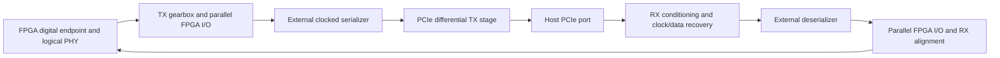

# Approved external serialization architecture

Status: **accepted by the user, 2026-11-07**. This locks the physical-interface direction for the Tang Nano 20K endpoint. Component selection, pin assignments and circuit feasibility remain implementation work.

User refinement: **first plan and evaluate a serializer built from solderable discrete transistors**. Follow the [discrete-transistor construction plan](discrete-transistor-serializer-plan.md) and PCIE-045 before PCIE-007 full TX integration or packaged-serializer selection. This is a required first route, not proof that the circuit is feasible.

The SystemVerilog core implements the transaction layer, data link layer and logical PHY, including scrambling and 8b/10b coding. Slower FPGA I/O transports the encoded bits to and from external high-speed circuitry. External circuitry performs TX serialization and differential driving, and RX conditioning, clock/data recovery and deserialization. The PCIe lane remains Gen1 x1 at 2.5 GT/s in each direction.

The initial **TX feasibility candidate** is four parallel streams at 625 Mb/s each, interleaved by a clocked 4:1 serializer into one 2.5 Gb/s encoded stream. This is a throughput allocation, not proof of pin or clock feasibility. Each group of four bits spans 1.6 ns; outgoing serial bit intervals are 400 ps. The four streams are serializer inputs, not four PCIe lanes. RX must provide the corresponding aggregate throughput with a recovered clock; its exact parallel width may differ.

The core's symbol-interface width and logical clock are frozen in PCIE-001 before RTL begins; the proposed default is two decoded symbols plus K flags per 125 MHz cycle, because one byte per 250 MHz cycle is unlikely to close timing on GW2AR-18. Its 10-bit encoded output needs an explicit gearbox into the external parallel format. Four-bit groups cross 10-bit symbol boundaries; preserve continuous bit order, training/control symbols and running disparity. Select a different parallel width or an equivalent fabric pipeline if timing, primitive support or board pins require it, recording the rationale in PCIE-003/004. No particular mux chip, external clock topology or voltage interface is approved by this decision.

The external clocking arrangement must support the serializer's required capture/select timing and establish a deterministic phase relation to the FPGA data. Do not assume the FPGA can directly generate high-speed mux select signals, or that a data-port bandwidth rating guarantees a sufficiently fast select port. Verify jitter, setup/hold, skew and level translation for the selected components. RX clock recovery must work independently of the local transmit clock. Section 4.3.1.1 requires both link ends to transmit within 600 ppm of each other, so the TX bit clock should derive from the host 100 MHz REFCLK unless the host is known to run without spread-spectrum clocking; PCIE-001 freezes this policy and PCIE-003 owns the clock architecture.

PCIe-specific electrical functions remain part of the external circuit/control contract: TX amplitude and de-emphasis, AC coupling and termination, electrical idle generation/detection, receiver detection, reset, power-state behavior and applicable wake signaling. A fast mux alone is not a complete PHY. The FPGA controls these functions through explicitly timed status/control interfaces.

The [HMC854 documentation](https://www.analog.com/en/products/hmc854.html) is an architectural reference only; the first design route is discrete transistors, not that IC. Any transistor/component choice requires its own operating-rate, timing, power, voltage and model review. A complete external PHY that absorbs scrambling/encoding would change the approved partition and must be documented as a separate architecture change; it must not silently duplicate or bypass the logical PHY under development. Direct single-pair GPIO transmission and native-transceiver substitution are not the planned architecture.

Verification and ownership:

- PCIE-003 freezes the external parallel/control contract and feasible parts/clocking candidates; PCIE-004 defines its simulation and fabric boundaries.
- PCIE-046 assesses RX clock-recovery feasibility, including relock time against the N_FTS/L0s budget, before TX parts are bought or coupons fabricated.
- PCIE-007 designs TX pin schedules, clocked serialization and output circuitry. PCIE-008 designs the complete RX/CDR/deserialization path.
- PCIE-009 converts reproducible pyuvm bit/pin manifests into ngspice stimuli and numerical reports. pyuvm checks exact serial ordering across gearbox boundaries, ordered sets, reset, stalls and lock loss.
- ngspice uses finite FPGA slew, skew, supported pin rates and component/channel models to check serializer timing, transient glitches, jitter, output levels, de-emphasis, eye limits and RX assumptions. An ideal 2.5 Gb/s source is not a substitute for modeling the serializer.
- PCIE-040 implements the board adapter, PCIE-041 establishes core resource/timing fit, and PCIE-043/044 qualify the electrical path and physical host operation.

The user's [I/O-reference fallback](hardware-target.md) remains valid if the digital core cannot fit after documented optimization. The same external serialization architecture and GW2AR I/O limits continue to apply in simulation. Architecture acceptance is not a passing electrical test; unsuccessful circuits must be reported as unsuccessful.
