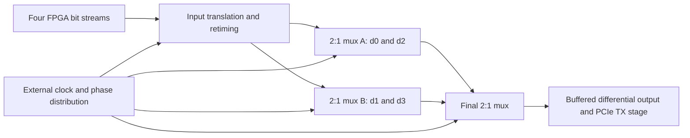

> **Superseded 2026-11-07.** The project now targets SkyWater SKY130 with an on-chip PHY; see [ASIC target](../asic-target.md) and [PHY architecture](../phy-architecture.md). Kept for history only; links in this file may point to documents that no longer exist.

# First implementation plan: solderable discrete-transistor serializer

This is the required first TX serializer design route, following the user's instruction. It refines the [accepted external serialization architecture](physical-interface-decision.md). The deliverable at this stage is a construction and verification plan, not a released schematic or an assertion of 2.5 Gb/s operation. Packaged serializer IC selection must follow the discrete-transistor evaluation rather than replace it at the outset.

## Target and circuit partition

Start with four encoded FPGA streams at 625 Mb/s each. Interleave each four-bit group into `d0,d1,d2,d3` at 2.5 Gb/s: one output bit every 400 ps and one new parallel group every 1.6 ns. FPGA resources still provide scrambling, 8b/10b, the 10-to-4-bit gearbox and pattern generation. The external transistor circuit supplies input translation/retiming, serialization and clock distribution. The PCIe differential output/control stage and external RX/CDR remain required separate circuits.

Use **non-saturating differential bipolar current-steering logic**, with resistive collector loads, controlled tail currents and emitter-follower buffering/level shifting where needed. Keep internal swings small to reduce capacitive charging. Do not start with saturated common-emitter inverter chains. Solderable means surface-mount discrete transistors on a purpose-designed PCB; package leads, pads and interconnect are part of the circuit.

Each first-stage branch produces 1.25 Gb/s; the final stage alternates branches to produce 2.5 Gb/s. A nominal 625 MHz selector waveform provides the first-stage alternation, and a 1.25 GHz selector waveform provides the final alternation. These are internal external-circuit clocks, not requests for ordinary FPGA pins to generate GHz select signals.

The drawing is a topology proposal. It omits phase offsets and latch placement that must be designed before it can operate reliably. Changing a first-stage selector when the final mux selects that branch creates a race. Establish staggered update windows and/or branch latches so each branch settles before its output is selected. Generate an edge-by-edge timing diagram covering an entire 1.6 ns group, including gate delay, clock duty cycle and group-boundary input updates. A tree driven by ideal simultaneous selects is not an acceptable implementation.

## 1. Select transistor candidates and qualify their models

First evaluate **Infineon BFP420**, a discrete RF NPN in SOT343. Its [manufacturer datasheet, revision 3.0](https://www.infineon.com/assets/row/public/documents/24/49/infineon-bfp420-datasheet-en.pdf) describes a typical 25 GHz transition frequency at its stated bias conditions. This identifies a candidate with useful RF bandwidth; transition frequency is a small-signal current-gain parameter, not a guaranteed digital toggle rate. Check actual gain, capacitance, bias, breakdown, dissipation and package pinout at every proposed operating point.

SOT23 devices may be easier to assemble manually but must earn their place through timing/model checks. The [NXP BFR93A page](https://www.nxp.com/products/BFR93A) documents a 6 GHz SOT23 device and model resources, but marks that manufacturer's product discontinued. Treat it as a historical comparison/model candidate, not the committed procurement choice. Avoid generic low-frequency transistor models substituted merely because they converge.

Deliver a candidate table containing exact manufacturer/part/package, source revision, current availability check, nonlinear model provenance/license, pin mapping, model operating range and package parasitics. Obtain a nonlinear transient-capable manufacturer model compatible with ngspice, or document and validate a defensible equivalent. S-parameters alone cannot describe the large-signal switching and bias behavior. An unavailable trustworthy model is a blocker to quantitative circuit claims, not grounds to invent parameters.

## 2. Design and validate one differential gate and one 2:1 mux

Begin with a differential pair, tail-current source, collector loads and a representative next-stage load. Sweep tail current and load resistance within the device's operating limits. Choose bias points from the model and datasheet rather than prescribing a supply voltage now. Check every transistor's DC and transient headroom, reverse junction stress and dissipation. Bias/reference circuitry may use slower devices only where its bandwidth and noise contribution are acceptable.

For the proposed 2:1 current-steering mux, use two upper differential data pairs feeding shared differential collector loads and a lower differential selector pair steering the tail current between them. This uses six fast switching transistors before adding the tail source, buffers, references or retiming latches. The stacked pairs require different data/select common modes and adequate voltage headroom; an FPGA LVDS output cannot simply be wired to every transistor base. Produce an actual transistor-labelled schematic and verify its truth table before counting it as a working mux.

Estimate load swing with `delta_V ≈ I_steered × R_effective`; effective resistance includes the next stage and measurement load. Calculate total tail-current power, follower current and supply dissipation across the entire tree and clock network. Do not treat an unloaded gate's edge rate as its loaded fanout capability. Keep devices out of saturation throughout switching and idle transitions.

Build isolated simulation fixtures for the pair, follower, mux data path and mux select path. Test static data, independently changing inputs and fast selection between opposite levels. Measure select-to-output timing separately from data-to-output timing. Include startup and an undefined selector until reset establishes phase.

## 3. Solve clock generation, retiming and FPGA interface

For the first laboratory coupon, permit an external low-jitter differential clock generator/instrument to isolate serializer feasibility from oscillator design. It is not part of the transistor data path. Production clock generation must subsequently be tied to an appropriate reference with a complete jitter/frequency budget; do not assume the board's MS5351 or oscillator satisfies that budget.

Design solderable differential buffers, clock fanout and any divide-by-two/phase-generation cells needed by the tree. If a discrete divider is required, qualify its master/slave differential latches and deterministic reset before using it as an ideal divide-by-two source. Identify clocks that are externally supplied in each experiment. Replacing ideal clock sources with the actual clock distribution is a required integration step.

Specify the chosen FPGA I/O mode, supported rate, voltage, common mode, finite edges, skew and source-synchronous timing from the GW2AR and actual board documents. Design DC level translation/attenuation and input termination to match the transistor circuit. Encoded parallel substreams can contain long constant runs even when the final serial stream has 8b/10b run-length limits; AC coupling those internal data paths requires a demonstrated baseline-wander analysis. Arrange retiming/group updates without dropping data or applying wire backpressure.

Write setup/hold and clock-phase inequalities for each latch and mux input over all corners. Initial exploration budgets may target 60–100 ps output edges and tens of ps of residual clock/data uncertainty, but these are engineering allocation targets, not PCIe limits or measured results. Final acceptance uses the source-cited Chapter 4.3 masks and timing requirements from PCIE-006. Constant pipeline latency can exceed one UI; what matters is preserved order, throughput, setup/hold and eye margin. Do not incorrectly require the sum of all propagation delays to be below 400 ps.

## 4. Assemble and evaluate staged PCB coupons

Use short, symmetric differential routing over a continuous reference plane, preferably a four-layer stack with a nearby ground plane. Set impedance from the actual stackup and interfaces. Include local decoupling, low-inductance returns, short current-source connections, thermal paths and controlled clock loading. No solderless breadboards or long transistor breakout wires in the high-speed paths.

Use manufacturer land patterns and accessible discrete SMD packages; plan microscope-assisted assembly, flux and fine-tip or hot-air/reflow work. Start with a one-mux coupon, then a two-stage serializer coupon; expose removable/isolated loads so the first stage can be measured without corrupting final-stage routing. Budget pads, solder, connector launches, vias and probe loading in simulation. Standard passive probe capacitance must not silently become an enormous unmodeled output load; specify a calibrated high-bandwidth differential or properly terminated sampling arrangement.

Do not order a full endpoint daughterboard before the gate/clock coupon is characterized. Compare observed bias, select latency, edge shape and skew with predicted values, update model parameters with provenance, and only then lay out the complete tree. No parts purchase or PCB fabrication is performed by this planning change.

## 5. Verify in ngspice and pyuvm

Run ngspice batch simulations in this order: bias and static truth tables; loaded gate transitions; clock/select path; latches/divider; two-input mux; complete clocked four-input tree; FPGA-interface corners; final TX stage and channel. Start transient maximum timestep at 10 ps or less (UI/40 at 2.5 Gb/s), then halve it and check that delay and eye measurements converge. Record convergence aids and confirm they do not artificially improve edge shape or timing.

Use manufacturer-rated voltage/temperature ranges and documented statistical assumptions for device mismatch. Sweep package/trace parasitics, load, skew, duty-cycle distortion and clock jitter. A fixed scalar delay or arbitrary noise source is not a validated transistor/package model. Preserve good and deliberately bad fixtures so automated checks demonstrate detection of glitches, saturation, order errors and eye failure.

pyuvm owns the independent expected bitstream and exports parallel pin/clock-event manifests through PCIE-009. Generate all four-bit combinations, persistent opposite-valued branches, simultaneous input changes, exhaustive adjacent group transitions, long substream runs, random legal encoded packets, training ordered sets, SKP, reset and phase-reinitialization cases. Test 10-bit symbol boundaries crossed by four-bit transfers. Decode sampled analog output using the expected timing and compare against the original bitstream; do not check only average output frequency or a repeating pattern.

Report truth-table agreement, exact bit order, lost/duplicated bits, setup/hold aperture, select-path settling, output swing, crossing times, jitter, eye-mask violations, maximum junction stress and power. A successful small coupon does not establish PCIe compliance. PCIE-007 integrates the complete serializer and PCIE-043 checks the complete electrical path. Electrical idle, de-emphasis and receiver detection must be added and tested before host attachment; RX/CDR is still PCIE-008.

## Deliverables and sequence

| Stage | Owner | Required output |
|---|---|---|
| Device/model and interface constraints | PCIE-003/006 | Candidate/model table, board I/O assumptions, electrical limit IDs |
| RX feasibility before hardware spending | PCIE-046 | Receive-path go/no-go/unknown recommendation, CDR lock-time and N_FTS budget; reported before coupon parts are bought |
| Discrete building blocks first | PCIE-045 | Transistor-labelled gate/mux/latch/clock schematics, nonlinear models, ngspice fixtures, bias/timing/corner reports and solderable coupon plan |
| Complete 4:1 TX serializer | PCIE-007, after PCIE-045 | Retimed tree, actual phase schedule, FPGA pin mapping, circuit/PCB/BOM, bit-exact and electrical evidence |
| Full link | PCIE-008/009/040/043/044 | RX recovery, integrated stimuli, board adapter, electrical qualification and eventual host tests |

PCIE-045 is a required first evaluation. Its result may be a qualified building-block design or a quantitative rejection identifying model, assembly, speed, power or jitter limits. A rejection must remain visible and cannot be reported as a successful serializer. Record the discrete evaluation before proposing a packaged-serializer alternative; any change of implementation direction must be explicitly agreed with the user. The existing core-fit I/O-reference fallback remains available and retains these transistor/circuit requirements in simulation.
